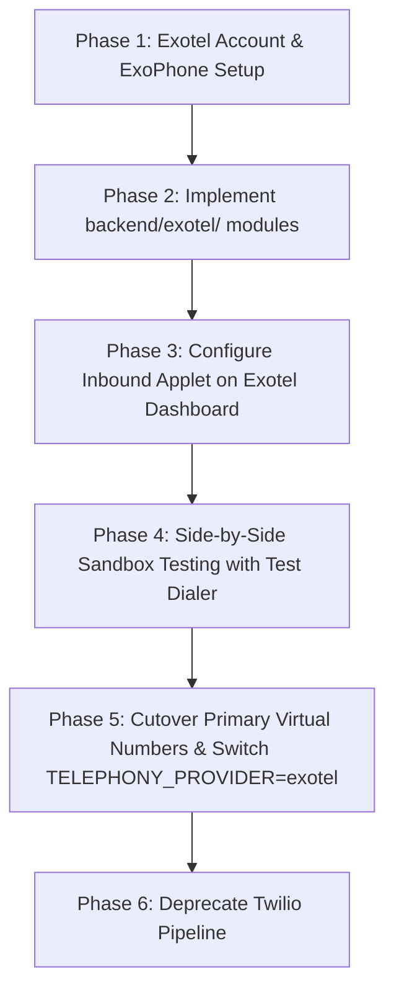

# VED Telephony Migration Plan: Twilio to Exotel

This document outlines the step-by-step engineering plan to migrate the **VED AI Voice Assistance Platform** from **Twilio** to **Exotel** without breaking existing backend functionality or degrading latency.

---

## 1. Executive Summary & Architecture Comparison

| Capability | Current Twilio Architecture | Target Exotel Architecture |
| :--- | :--- | :--- |
| **Outbound Calling** | `client.calls.create({ to, from, url })` via `@twilio/sdk` | `POST https://{api_key}:{api_token}@{subdomain}/v1/Accounts/{account_sid}/Calls/connect.json` |
| **Inbound Call Routing** | TwiML `<Response><Connect><Stream url="wss://..."/></Connect></Response>` | Exotel Flow / ExoML `<Response><Dial><Stream url="wss://..."/></Dial></Response>` |
| **Audio Protocol** | Bi-directional WebSocket, 8 kHz G.711 $\mu$-law chunks | Bi-directional WebSocket, Linear PCM 16 kHz / 8 kHz or $\mu$-law payload |
| **Caller ID Pool & Fallback** | Local fallback array iterated across Twilio numbers | Exotel Virtual Numbers (VN / ExoPhone numbers pool) |
| **Media Chunking** | 80ms chunks (640 bytes) @ 8 kHz mulaw | 20ms or 80ms frames with base64 encoded audio |

---

## 2. Exotel Prerequisites & Credentials

Add the following environment variables to `.env` and Render dashboard:

```env
# Telephony Provider Switch
TELEPHONY_PROVIDER=exotel # Options: 'exotel' | 'twilio'

# Exotel Credentials
EXOTEL_ACCOUNT_SID=your_exotel_sid
EXOTEL_API_KEY=your_exotel_api_key
EXOTEL_API_TOKEN=your_exotel_api_token
EXOTEL_SUBDOMAIN=api.exotel.com # or <region-subdomain>.exotel.com
EXOTEL_CALLER_ID=+918000123456 # Primary ExoPhone Virtual Number
EXOTEL_APP_ID=your_exotel_applet_id # Inbound Call Flow App ID
```

---

## 3. Detailed Component Migration Steps

### Step 3.1: Outbound Call Service (`backend/exotel/service.js`)

In Twilio, calls are initiated via `twilioClient.calls.create()`.  
In Exotel, calls are initiated using the **Call Connect API**:

```javascript
const axios = require('axios');
const { getNumbersPool, recordCallOnNumber } = require('../state/ved');

/**
 * Initiates an outbound call via Exotel with automatic fallback
 */
async function performExotelOutboundCall({ to, entityName = 'VED' }) {
  const accountSid = process.env.EXOTEL_ACCOUNT_SID;
  const apiKey = process.env.EXOTEL_API_KEY;
  const apiToken = process.env.EXOTEL_API_TOKEN;
  const subdomain = process.env.EXOTEL_SUBDOMAIN || 'api.exotel.com';
  const serverUrl = process.env.PUBLIC_BASE_URL || process.env.SERVER_URL;

  const authHeader = 'Basic ' + Buffer.from(`${apiKey}:${apiToken}`).toString('base64');
  const pool = getNumbersPool();
  const callerIds = pool.length > 0 
    ? pool.map(p => p.number) 
    : [process.env.EXOTEL_CALLER_ID].filter(Boolean);

  let callResult = null;
  let lastError = null;

  for (let i = 0; i < callerIds.length; i++) {
    const callerId = callerIds[i];
    try {
      const endpoint = `https://${subdomain}/v1/Accounts/${accountSid}/Calls/connect.json`;

      const params = new URLSearchParams();
      params.append('From', to);                      // Customer destination
      params.append('CallerId', callerId);            // Virtual ExoPhone number
      params.append('Url', `${serverUrl}/exotel/voice`); // Webhook URL for ExoML flow
      params.append('StatusCallback', `${serverUrl}/exotel/status`);
      params.append('CustomField', entityName);

      const response = await axios.post(endpoint, params.toString(), {
        headers: {
          'Authorization': authHeader,
          'Content-Type': 'application/x-www-form-urlencoded'
        }
      });

      const call = response.data.Call;
      recordCallOnNumber(callerId);
      callResult = { sid: call.Sid, from: callerId, status: call.Status };
      break;
    } catch (err) {
      console.warn(`[ExotelService] CallerID ${callerId} failed: ${err.message}`);
      lastError = err;
    }
  }

  if (!callResult) throw lastError || new Error('All Exotel caller lines exhausted');
  return callResult;
}

module.exports = { performExotelOutboundCall };
```

---

### Step 3.2: Inbound Webhook / ExoML Handler (`backend/exotel/webhook.js`)

When Exotel connects an inbound or outbound call, it queries your webhook. The server returns ExoML instructing Exotel to stream audio to your WebSocket endpoint:

```javascript
/**
 * Exotel Voice Webhook
 * Responds with ExoML to stream audio bi-directionally
 */
function handleExotelVoiceWebhook(req, res) {
  const serverUrl = process.env.PUBLIC_BASE_URL || process.env.SERVER_URL;
  const wsUrl = serverUrl.replace(/^http/, 'ws') + '/exotel/stream';

  const exoML = `<?xml version="1.0" encoding="UTF-8"?>
<Response>
  <Connect>
    <Stream url="${wsUrl}">
      <Parameter name="callSid" value="${req.body.CallSid || req.query.CallSid || ''}" />
      <Parameter name="caller" value="${req.body.From || req.query.From || ''}" />
    </Stream>
  </Connect>
</Response>`;

  res.set('Content-Type', 'application/xml');
  res.send(exoML);
}

module.exports = { handleExotelVoiceWebhook };
```

---

### Step 3.3: WebSocket Audio Stream Handler (`backend/exotel/stream.js`)

Exotel's streaming protocol sends WebSocket packets with event types: `connected`, `start`, `media`, and `stop`.

#### Payload Translation:
1. **Inbound audio from caller**:
   - Twilio sends `event: 'media'` with $\mu$-law chunks.
   - Exotel sends `event: 'media'` with Linear PCM 16kHz or 8kHz $\mu$-law base64 chunks.
   - We reuse the speech recognition pipeline (`getGroqSTT` / Whisper) which ingests standard 16 kHz PCM WAV.
2. **Outbound audio to caller**:
   - VED generates TTS via Google TTS / Sarvam.
   - We convert the audio buffer into the format expected by Exotel and send:
     ```json
     {
       "event": "media",
       "streamSid": streamSid,
       "media": {
         "payload": "<base64-encoded-audio>"
       }
     }
     ```

---

### Step 3.4: Dual-Provider Abstraction Switch (`backend/services/telephony.js`)

To prevent downtime and allow testing during cutover, we create a unified telephony adapter:

```javascript
const twilioService = require('../twilio/service');
const exotelService = require('../exotel/service');

const PROVIDER = process.env.TELEPHONY_PROVIDER || 'twilio';

async function initiateOutboundCall(params) {
  if (PROVIDER === 'exotel') {
    return exotelService.performExotelOutboundCall(params);
  }
  return twilioService.performOutboundCall(params);
}

module.exports = { initiateOutboundCall, PROVIDER };
```

In `backend/server.js`, route WebSocket connections based on the stream path:
- `/twilio/stream` $\rightarrow$ handles Twilio calls
- `/exotel/stream` $\rightarrow$ handles Exotel calls

---

## 4. Migration Execution Phases



1. **Phase 1 (Setup)**:
   - Procure Indian DID/Toll-Free ExoPhones for MMMUT (e.g., Gorakhpur / Delhi NCR local DIDs).
   - Set up API keys in Exotel Console.
2. **Phase 2 (Code implementation)**:
   - Add `backend/exotel/service.js`, `backend/exotel/webhook.js`, and `backend/exotel/stream.js`.
3. **Phase 3 (Applet Configuration)**:
   - On Exotel dashboard, create a "Passthru / Stream Applet" pointing to `https://<YOUR_RENDER_URL>/exotel/voice`.
4. **Phase 4 (Validation)**:
   - Place test calls from VED Operations Test Dialer to internal mobile numbers. Verify latency (<600ms), barge-in, and Indian accent clarity.
5. **Phase 5 (Production Cutover)**:
   - Set `TELEPHONY_PROVIDER=exotel` on Render.
   - Point MMMUT official helpline numbers to the new Exotel Virtual Numbers.

---

## 5. Risk Mitigation & Rollback Plan

- **Instant Rollback**: If Exotel incurs carrier drops, simply set `TELEPHONY_PROVIDER=twilio` in Render environment variables. The server switches back without code deployment.
- **Number Fallback Pool**: The VED fallback engine configured in **VED Operations** continues working unchanged, prioritizing Primary $\rightarrow$ Secondary $\rightarrow$ Tertiary lines.
